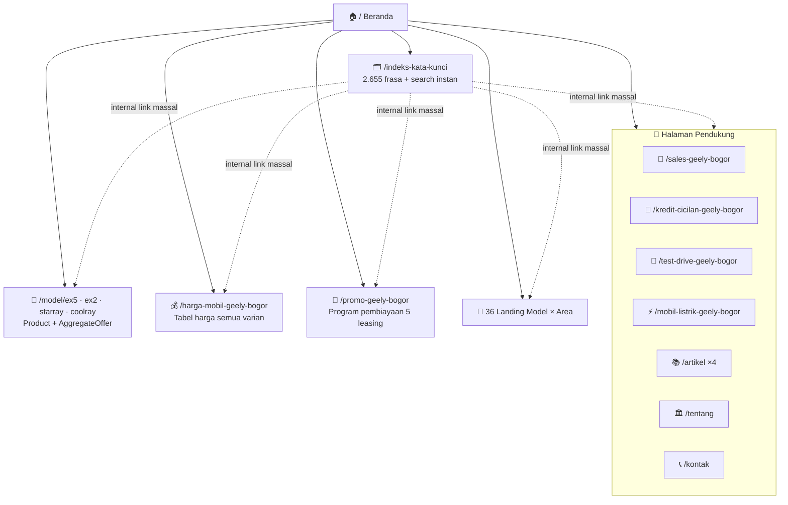

<div align="center">

# 🚗 PUSAT GEELY

### *Website Konsultan Penjualan Geely №1 untuk Bogor & Jabodetabek*

**EX5 · EX2 · Starray EM-i · Coolray** — Test Drive Fleksibel · Harga Transparan · Simulasi Kredit · Trade-in

[](https://nextjs.org)
[](https://react.dev)
[](https://typescriptlang.org)
[](https://tailwindcss.com)
[](https://prisma.io)
[](https://bun.sh)

[](#-seo-full-power-arsitektur)
[](#-seo-full-power-arsitektur)
[](#-seo-full-power-arsitektur)
[](#-struktur-data-json-ld-matrix)

*44 pintu masuk pencarian · 2.655 frasa kata kunci · IndexNow instan · Geely Bot AI · Dynamic OG Image · Sitelinks SearchAction*

</div>

---

<div align="center">

**🌐 Live** — [pusatgeely.web.id](https://pusatgeely.web.id) · **💬 WhatsApp** — [+62 816-6111-42](https://wa.me/62816611142) · **📄 Indeks Keyword** — [/indeks-kata-kunci](https://pusatgeely.web.id/indeks-kata-kunci) · **🩺 Diagnostik** — [/api/seo-status](https://pusatgeely.web.id/api/seo-status)

</div>

---

## ✨ Tentang Proyek Ini

**Pusat Geely** bukan sekadar website dealer — ini adalah **mesin pencarian-assisted selling** yang dibangun dengan satu filosofi: *setiap pertanyaan yang orang Indonesia ketik di Google tentang Geely harus punya pintu masuk ke halaman ini*.

Website ini melayani **Konsultan Penjualan Independen** (bukan dealer resmi — dan jujur soal itu) untuk seluruh lineup Geely Indonesia: **Geely EX5** (SUV listrik), **Geely EX2** (hatchback listrik), **Geely Starray EM-i** (SUV super hybrid), dan **Geely Coolray** (crossover turbo) di wilayah **Bogor, Depok, Jakarta, Tangerang, Bekasi, dan sekitarnya**.

Yang membuatnya berbeda dari website mobil pada umumnya:

| 🔍 Yang Dibangun | 🎯 Hasilnya |
|---|---|
| Arsitektur keyword engine 2.655 frasa | Cakupan long-tail dari *"harga geely ex5 bogor"* hingga *"cara kredit geely coolray jakarta"* |
| 44 halaman landing programatik | Setiap kombinasi **model × area** punya halaman bermutu dengan konten unik per-area |
| JSON-LD Knowledge Graph 10 tipe | Google memahami bisnis, produk, harga, FAQ, orang, organisasi, dan **SearchAction** |
| IndexNow bridge | Bing, Yandex & Seznam tahu konten baru **dalam hitungan detik**, bukan hari |
| 🤖 **Geely Bot (AI Assistant)** | Customer service AI 24/7 dengan data produk real-time + handoff WhatsApp |
| 🖼️ **Dynamic OG Image** | Kartu sosial branded otomatis per halaman (next/og + foto unit asli) |
| 🔎 **Sitelinks SearchAction** | Kandidat search box di hasil pencarian Google merek Anda |
| Prinsip *honesty-first* | Semua harga indikatif + disclaimer — membangun trust dan aman dari penalti |

---

## 📖 Daftar Isi

- [🛠️ Tech Stack](#️-tech-stack)
- [🚀 Quick Start](#-quick-start)
- [🚨 TROUBLESHOOTING: Error Sitemap di Google Search Console](#-troubleshooting-error-sitemap-di-google-search-console)
- [⚡ SEO Full Power (Arsitektur)](#-seo-full-power-arsitektur)
- [🗺️ Arsitektur Halaman](#️-arsitektur-halaman)
- [📊 Struktur Data (JSON-LD Matrix)](#-struktur-data-json-ld-matrix)
- [🗂️ Struktur Proyek](#️-struktur-proyek)
- [📡 IndexNow — Indeks Instan](#-indexnow--indeks-instan)
- [🚢 Deployment](#-deployment)
- [✅ Checklist Go-Live SEO](#-checklist-go-live-seo)
- [🧭 Prinsip Desain](#-prinsip-desain)
- [👤 Kredit & Support System](#-kredit--support-system)
- [📜 Lisensi](#-lisensi)

---

## 🛠️ Tech Stack

| Layer | Teknologi | Kenapa Dipilih |
|---|---|---|
| **Framework** | Next.js 16 (App Router, Turbopack) | SSG + metadata streaming + Image Optimization native |
| **UI** | React 19 + shadcn/ui + Radix | Aksesibel, composable, production-grade |
| **Styling** | Tailwind CSS 4 + tw-animate | Utility-first, zero-runtime CSS |
| **Bahasa** | TypeScript 5 (strict) | Tipe data produk & SEO jadi kontrak, bukan harapan |
| **Database** | Prisma 6 + SQLite | Lead capture berbasis database, zero-config |
| **AI** | z-ai-web-dev-sdk (LLM) | Geely Bot — asisten AI customer service 24/7 |
| **Animasi** | Framer Motion | Reveal on scroll yang halus tanpa jank |
| **Runtime** | Bun 1.3 | Install & start secepat kilat |
| **Bilingual** | Custom i18n (ID/EN) | Seluruh konten dua bahasa tanpa dependensi eksternal |

---

## 🚀 Quick Start

```bash
# 1️⃣ Clone
git clone https://github.com/prabudanling/pusatgeely.git
cd pusatgeely

# 2️⃣ Install (Bun — disarankan)
bun install

# 3️⃣ Database (SQLite — otomatis)
bun run db:push && bun run db:generate

# 4️⃣ Development
bun run dev          # → http://localhost:3000

# 5️⃣ Production
bun run build        # SSG semua 50+ halaman
bun run start        # Standalone server
```

### Environment Variables

```bash
# ⭐ PENTING untuk SEO (lihat bagian troubleshooting di bawah)
NEXT_PUBLIC_SITE_URL=https://pusatgeely.web.id   # Domain final produksi

# Verifikasi Search Console (opsional — aktif saat env diset)
NEXT_PUBLIC_GOOGLE_SITE_VERIFICATION=xxx         # Google Search Console
NEXT_PUBLIC_BING_VERIFICATION=xxx                # Bing Webmaster Tools
NEXT_PUBLIC_YANDEX_VERIFICATION=xxx              # Yandex Webmaster

# Analytics (opsional)
NEXT_PUBLIC_GA_ID=G-XXXXXXXXXX                   # Google Analytics 4
```

> 💡 **Tanpa `NEXT_PUBLIC_SITE_URL`**: situs otomatis mendeteksi domain dari
> `VERCEL_PROJECT_PRODUCTION_URL` / `VERCEL_URL` (di Vercel) atau fallback ke
> `https://pusatgeely.web.id`. Cek nilai aktif kapan pun di **`/api/seo-status`**.

Tanpa env apa pun → website tetap berjalan penuh, **nol script analitik, nol beban**.

### 📊 Analytics & Event Konversi (GA4-ready)

Semua interaksi konversi dilacak via lapisan analitik ringan **`src/lib/analytics.ts`** —
push ke `window.dataLayer`, **tanpa dependensi & tanpa script pihak ketiga tambahan**.
Kompatibel GA4 (`gtag`) maupun Google Tag Manager.

**Cara mengaktifkan GA4:**

1. Buat property GA4 → salin **Measurement ID** (format `G-XXXXXXXXXX`).
2. Vercel → `Settings → Environment Variables` → set `NEXT_PUBLIC_GA_ID` → **Redeploy**
   (env terbaca saat build).
3. Script `gtag.js` hanya dimuat bila env diset (env-gated di `layout.tsx`).

**Verifikasi realtime:** buka GA4 → **Reports → Realtime**, lalu klik tombol WhatsApp
atau kirim form test drive di website — event muncul dalam ±30 detik.

**Event konversi yang terlacak:**

| Event | Parameter | Pemicu |
|---|---|---|
| `wa_click` | `location` (`floating_cta`, `ai_chat`) | Klik tombol / handoff WhatsApp |
| `generate_lead` | `form` (`test_drive`), `model` (id model atau `any`) | Form test drive terkirim sukses |
| `chat_open` | — | Panel Geely Bot (AI chat) dibuka pertama kali |
| `quiz_complete` | `model` | Kuis Model Matcher selesai (homepage `#kuis`) |
| `calculate_credit` | `model` | Simulasi kredit dijalankan |
| `ev_cost_calc` | `model` | Kalkulator hemat EV vs bensin dipakai (halaman model listrik) |

> 📌 Event masuk ke `dataLayer` → otomatis tampil di GA4 sebagai **event custom**
> (Reports → Events). Untuk menghitungnya sebagai konversi:
> **Admin → Events → pilih event → toggle "Mark as key event"**.

---

## 🚨 TROUBLESHOOTING: Error Sitemap di Google Search Console

> *"Kami mengalami error saat mencoba mengakses peta situs Anda. Harap pastikan
> peta situs Anda ada di alamat yang ditentukan dan tidak diblokir ke Google."*

Error ini punya **4 penyebab** — periksa berurutan (5 menit):

### Penyebab #1 — Host sitemap ≠ host di GSC property (PALING SERING)

Sitemap **HARUS** berisi URL dari host yang sama dengan lokasi sitemap-nya.
Contoh salah: sitemap disubmit dari `pusatgeely.vercel.app` tetapi isinya URL
`pusatgeely.web.id` → Google menolak (host mismatch).

✅ **Solusi permanen (sudah tertanam di kode ini):** `SITE_URL` kini dinamis —
mengikuti `NEXT_PUBLIC_SITE_URL` → `VERCEL_PROJECT_PRODUCTION_URL` → fallback.
Set env di Vercel:

```
Settings → Environment Variables → Add:
  NEXT_PUBLIC_SITE_URL = https://pusatgeely.web.id   (atau domain final Anda)
```

Lalu **Redeploy** (wajib — env terbaca saat build). Semua canonical, sitemap,
JSON-LD, dan OG image otomatis mengikuti domain tersebut.

### Penyebab #2 — Vercel Deployment Protection aktif

Jika aktif, Googlebot menerima **401/403** → "Couldn't fetch".

```
Vercel → Project → Settings → Deployment Protection → matikan SEMUA
(Vercel Authentication, Password Protection, Trusted IPs) untuk production.
```

### Penyebab #3 — Property GSC salah jenis

| Property type | Isi yang benar |
|---|---|
| **Domain** (`pusatgeely.web.id`) | Verifikasi via DNS TXT di registrar domain |
| **URL Prefix** (`https://pusatgeely.web.id/`) | Harus persis `https://` + tanpa `www` — sesuai versi yang dipakai canonical |

Jika domain Anda baru di-pointing ke Vercel, **DNS bisa butuh 24-48 jam** —
cek dulu dengan: `curl -I https://domain-anda.com/sitemap.xml` → harus `200`.

### Penyebab #4 — Transient "Couldn't fetch" (biasakan sabar)

GSC sering gagal fetch di jam-jam pertama setelah submit — **ini normal**.
Tunggu 24-72 jam, lalu klik **Resubmit**. Sambil menunggu, percepat lewat:

1. **URL Inspection** (kotak pencarian atas GSC) → masukkan URL utama →
   **Request Indexing** untuk 3-5 halaman terpenting.
2. Bing/Yandex: `POST /api/indexnow` (lihat bagian IndexNow).

### 🩺 Alat diagnostik bawaan

Buka **`https://domain-anda.com/api/seo-status`** setelah deploy — endpoint ini
memeriksa: host request vs host canonical, jumlah URL sitemap, robots.txt,
keyword engine, dan mencetak checklist GSC yang bisa Anda ikuti persis.

---

## ⚡ SEO FULL POWER (Arsitektur)

### 1. 🧠 Keyword Engine — `src/lib/seo-keywords.ts`

```mermaid
flowchart LR
    A[4 Model<br/>EX5·EX2·Starray·Coolray] --> D{Kombinatorik<br/>Deterministik}
    B[25 Area<br/>Bogor→BSD] --> D
    C[20 Intent<br/>harga·kredit·test drive] --> D
    D --> E[Grid A: Model × Intent × Area<br/>2.000 frasa]
    D --> F[Grid B: Intent × Area<br/>300 frasa]
    D --> G[Grid C: EV & Hybrid<br/>108 frasa]
    D --> H[Pertanyaan Alami<br/>107 frasa]
    D --> I[Brand + Warna/Spec + Tahun<br/>140 frasa]
    E & F & G & H & I --> J[(2.655 frasa unik<br/>+ route tujuan)]
    J --> K[meta keywords<br/>per halaman]
    J --> L[/indeks-kata-kunci<br/>hub 2.655 internal link<br/>+ search box instan]
    J --> M[JSON-LD keywords]
```

**Prinsip anti-spam yang dipatuhi:** setiap frasa **wajib** menunjuk ke halaman nyata yang menjawabnya. Tidak ada keyword stuffing, tidak ada frasa fiktif.

### 2. 🏭 Landing Grid Programatik — `src/lib/landing-grid.ts`

```
4 Model × 9 Area (Jakarta, Depok, Tangerang, Bekasi,
Sentul, Cibinong, Cibubur, BSD, Kab. Bogor)
= 36 halaman + 8 halaman manual + halaman statis
= 44 pintu masuk pencarian
```

Setiap halaman grid membawa: tabel harga asli, flavor teks per-area, 5 FAQ lokal,
simulator kredit interaktif, form test drive, 5 internal link saudara, dan metadata lengkap.

### 3. 🤖 Geely Bot — AI Assistant (baru)

- Endpoint `/api/chat` (rate-limited) — LLM dengan system prompt berisi data
  produk & bisnis **live dari kode** → jawaban akurat + honesty-first.
- Widget floating di seluruh halaman: suggestion chips, typing indicator,
  render markdown, **handoff otomatis ke WhatsApp** setelah diskusi.

### 4. 🖼️ Dynamic OG Image (baru)

- `opengraph-image.tsx` (beranda) + `model/[slug]/opengraph-image.tsx` —
  kartu 1200×630 branded berisi foto unit asli (sharp WebP→PNG) + harga + spesifikasi.

### 5. 🗺️ Teknis On-Page

| Teknik | Status |
|---|---|
| Canonical + hreflang (id-ID/en) — **domain dinamis** | ✅ Semua halaman |
| OpenGraph + Twitter Card + OG image dinamis | ✅ Semua halaman |
| `robots.txt` + `sitemap.xml` dinamis (59 URL) | ✅ |
| Sitelinks **SearchAction** + search box nyata | ✅ `/indeks-kata-kunci?q=` |
| PWA Manifest · humans.txt · IndexNow key | ✅ |
| Breadcrumb visual + JSON-LD | ✅ |
| Verifikasi Search Console (3 mesin) via env | ✅ |

---

## 🗺️ Arsitektur Halaman



---

## 📊 Struktur Data (JSON-LD Matrix)

| JSON-LD | Tipe | Isi Kunci |
|---|---|---|
| `layout.tsx` | `AutoDealer` | Bisnis, jam, area layanan, telepon, price range, `sameAs` |
| `layout.tsx` | `FAQPage` | 8 FAQ nyata → rich result dropdown |
| `layout.tsx` | `WebSite` + **`SearchAction`** | Kandidat sitelinks search box |
| `layout.tsx` | `@graph` | 2 Person + 3 Organization ter-link `@id` |
| `[landing]/page.tsx` | `BreadcrumbList` + `FAQPage` + `Service` | Semua landing |
| `model/[slug]/page.tsx` | `Product + AggregateOffer` | Harga low/high per varian |
| `artikel/[slug]/page.tsx` | `Article` | Author, tanggal, publisher |
| `indeks-kata-kunci/page.tsx` | `CollectionPage + ItemList` | Peta topik situs |

---

## 🗂️ Struktur Proyek

```
pusatgeely/
├── src/
│   ├── app/
│   │   ├── layout.tsx              # Metadata global + Knowledge Graph + SearchAction
│   │   ├── page.tsx                # Beranda
│   │   ├── [landing]/page.tsx      # Router 44 halaman landing SEO
│   │   ├── model/[slug]/           # Detail 4 model + OG image dinamis
│   │   ├── api/chat/               # 🤖 Geely Bot (LLM, rate-limited)
│   │   ├── api/seo-status/         # 🩺 Diagnostik SEO pasca-deploy
│   │   ├── api/indexnow/           # ⚡ Bridge indeks instan Bing/Yandex
│   │   ├── api/leads/              # Form test drive → database
│   │   ├── sitemap.ts · robots.ts · manifest.ts
│   │   └── opengraph-image.tsx     # 🖼️ OG image dinamis beranda
│   ├── lib/
│   │   ├── site.ts                 # ⭐ Single source of truth + SITE_URL dinamis
│   │   ├── seo-keywords.ts         # 🧠 Mesin 2.655 kata kunci
│   │   ├── landing-grid.ts         # 🏭 Generator 36 landing model×area
│   │   └── ...
│   └── components/                 # 35+ komponen (termasuk ai-chat-widget, keyword-explorer)
├── prisma/schema.prisma            # Model Lead
├── vercel.json                     # Header cache sitemap/robots + security
├── public/                         # Foto unit asli, promo PDF, humans.txt, IndexNow key
└── db/custom.db                    # SQLite
```

---

## 📡 IndexNow — Indeks Instan

```bash
# Ping URL (host mengikuti domain aktif — web.id atau vercel.app)
curl -X POST https://<domain-anda>/api/indexnow \
  -H "Content-Type: application/json" \
  -d '{"urls": ["https://<domain-anda>/geely-ex5-jakarta"]}'
```

- 🔑 Key file: `public/bc336b4b6001017bc99244eba80d0206.txt`
- 🛡️ Validasi host ketat: `pusatgeely.web.id` + host deployment aktif
- 📊 Kuota: 10.000 URL/hari

> Google tidak memakai IndexNow — untuk Google, submit sitemap di Search Console + URL Inspection.

---

## 🚢 Deployment

### Vercel (paling cepat)

```bash
bunx vercel --prod
```

**Wajib setelah deploy pertama:**
1. Set env `NEXT_PUBLIC_SITE_URL` = domain final (lihat troubleshooting #1) → **Redeploy**
2. Matikan **Deployment Protection** (troubleshooting #2)
3. Cek **`/api/seo-status`** → semua checks `pass: true`
4. Submit `https://domain-anda.com/sitemap.xml` di GSC

### VPS + Standalone

```bash
bun run build && bun run start    # :3000 — Caddyfile siap pakai
```

> ⚠️ Ganti domain? Cukup update `NEXT_PUBLIC_SITE_URL` — seluruh canonical, sitemap, dan JSON-LD mengikuti otomatis.

---

## ✅ Checklist Go-Live SEO

- [ ] Set `NEXT_PUBLIC_SITE_URL` = domain final → **redeploy**
- [ ] Cek `/api/seo-status` → semua check pass
- [ ] Matikan Vercel Deployment Protection
- [ ] Submit sitemap: **Google Search Console** → Sitem → `sitemap.xml`
- [ ] Request Indexing via URL Inspection untuk 3-5 halaman utama
- [ ] Submit sitemap: **Bing Webmaster Tools** → Sitem
- [ ] Ping IndexNow semua URL utama
- [ ] Pasang env verifikasi (GSC / Bing / Yandex) → redeploy
- [ ] Buat **Google Business Profile** (konsisten dengan NAP di JSON-LD)
- [ ] Taruh link balik dari 6 sosial media (perkuat `sameAs`)
- [ ] Pantau 2 minggu pertama: GSC → Performance → Query

---

## 🧭 Prinsip Desain

1. **Honesty-first** — harga selalu *indikatif* + disclaimer; tidak ada klaim dealer resmi; tidak ada testimoni fiktif. Trust adalah SEO jangka panjang.
2. **Anti-fabrication** — data produk hanya dari riset multi-sumber publik.
3. **Setiap klik bernilai** — tidak ada tautan mati; 2.655 frasa semua mengarah ke jawaban nyata.
4. **Bilingual ID/EN** — pasar lokal utama, kredibilitas internasional tetap ada.
5. **Performance = ranking** — SSG murni, nol script wajib, image WebP optimized.

---

## 👤 Kredit & Support System

| | |
|---|---|
| **Business Owner / Sales Consultant** | Sena Sulaeman |
| **Digital Support System** | **H. Gugun Gunara** *(prabudanling · santri angon)* — [topkonsultan.web.id](https://topkonsultan.web.id) · [digiman.id](https://digiman.id) |
| **Co-Founder & Digital Systems** | **Muhammad Lutfi Azmi** |
| **Perusahaan** | PT Top Konsultan Internasional · PT Digital Bisnis Manajemen (Digiman) |

---

## 📜 Lisensi

Proyek privat — hak milik **Pusat Geely** & digital support system.
Dibangun dengan presisi oleh *master polymath, sage universal, the ultimate problem solver.* ⚡

<div align="center">

**[⬆ Kembali ke atas](#-pusat-geely)**

*Made with 🔥 in Bogor, Indonesia*

</div>
